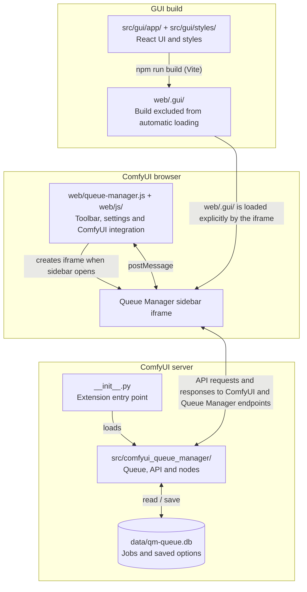

# Developing Queue Manager

This is the short path from a fork to a working change. For endpoint details, see [API.md](API.md); for user-facing behavior, see the [manual](README.md#manual).

For ComfyUI itself, see the [official developer documentation](https://docs.comfy.org/development/overview) and [custom node development guide](https://docs.comfy.org/custom-nodes/overview).

## Set up your fork

You need a working ComfyUI installation, Git, and Node.js 22.12 or newer with npm. Bun can also be used for the GUI. Use ComfyUI's Python environment for the Python commands below; the automated checks currently use Python 3.12.

1. Fork the repository on GitHub.
2. Clone your fork inside ComfyUI's `custom_nodes` folder. Keep the checkout named `comfyui_queue_manager`, because the browser asset paths use that name. Have only one copy of the extension installed.

From `custom_nodes`, replacing `YOUR_USERNAME`:

```sh
git clone https://github.com/YOUR_USERNAME/comfyui_queue_manager.git comfyui_queue_manager
cd comfyui_queue_manager
git switch -c my-change
python -m pip install ".[dev]"
```

Install and build the GUI from the repository root:

```sh
cd src/gui
npm ci
npm run build
cd ../..
```

Start ComfyUI as usual and open Queue Manager. The Python part runs inside ComfyUI and uses its queue and server.

## Where things live

| Path | Purpose |
| --- | --- |
| `__init__.py` | Loads the extension, registers its nodes, and reads the version from `pyproject.toml`. |
| `src/comfyui_queue_manager/` | Python code. Start with `qm_queue.py` for queue behavior, `qm_server.py` for endpoints, `qm_db.py` for database setup, and `nodes.py` for the Workflow Name node. |
| `web/queue-manager.js` and `web/js/` | Connect the extension to ComfyUI: toolbar, sidebar, settings, queue naming, and messages to/from the React app. |
| `src/gui/app/` | React app. `index.jsx` ties the screen together; `components/` contains the UI, `stores/` holds its state, and `internals/` contains shared logic and API helpers. |
| `src/gui/styles/` | GUI styles. |
| `web/.gui/` | Generated GUI. The leading dot excludes it from ComfyUI's automatic extension loading. The Queue Manager sidebar iframe loads it explicitly. |
| `data/qm-queue.db` | Local SQLite database, created automatically. Holds jobs and saved options; keep it out of commits. |
| `tests/` | Python and JavaScript checks. |

When the Queue Manager sidebar opens, its iframe explicitly loads `web/.gui/index.html` and the built React app. The app calls the Python endpoints for queue operations and uses browser `postMessage` messages to exchange settings, workflow-loading requests and progress with `web/js/functions.js`.

### Project and build flow



Run the build from `src/gui`. ComfyUI automatically loads `web/queue-manager.js`, which sets up the sidebar. The `.gui` build loads only when the sidebar iframe is opened.

## Make a change and try it

| What you changed | How to load the change |
| --- | --- |
| Python code | Restart ComfyUI. |
| Files directly under `web/`, such as `web/js/` or `web/styles/` | Refresh the full ComfyUI browser page. |
| React code or styles under `src/gui/` | Run `npm run build` from `src/gui`, then refresh the browser. |


### Optional: automatic GUI reload while editing

For quicker React edits, run the GUI development server:

1. In `web/js/config.js`, temporarily set `QM_ENVIRONMENT` to `"development"`.
2. Start ComfyUI from its own folder with permission for the local GUI to make requests:

```sh
python main.py --port 8188 --enable-cors-header http://localhost:3000
```

3. In a second terminal, from `src/gui`, run:

```sh
npm run dev
```

4. Open ComfyUI at `http://127.0.0.1:8188` and open Queue Manager. Its frame now loads from `http://localhost:3000` and updates as you edit.

The addresses must match `QM_DEV_URL` in `web/js/config.js` and `baseURL` in `src/gui/app/internals/config.js`. Restore `QM_ENVIRONMENT` to `"production"` before committing, then build and check the normal ComfyUI view once more.

## Run the checks

From the repository root:

```sh
python -m pytest -q tests/
ruff check .
node --test tests/workflow-name.test.mjs tests/workflow-filters.test.mjs tests/queue-selection.test.mjs tests/queue-reorder.test.mjs tests/queue-metadata.test.mjs
```

These are the checks run for pull requests. For GUI changes, also run `npm run build` from `src/gui` and try the affected behavior in ComfyUI. Automated tests do not replace that browser check.

Add a focused regression test for a bug fix. Existing queue tests show how to replace ComfyUI services and use a temporary database; You can follow those patterns so tests do not touch a real queue. Importing the extension's root `__init__.py` starts Queue Manager and requires ComfyUI.

## Send a contribution

Keep the change focused on one fix or feature. Update the relevant documentation when behavior changes. 

DON'T include the rebuilt `web/.gui` files in pull request when changing the React app. 

Before opening a pull request, review the diff, run the checks, and remove local-only files such as databases, logs, dependency folders and source maps. Push your branch to your fork, then open a pull request to the original repository. Explain the problem, what changed, and what you tested; For a visible UI change include a screenshot.

For a release update, keep the version in `pyproject.toml`, the changelog and `src/gui/app/components/SplashScreen.jsx` aligned, and rebuild the GUI after changing the splash.
