# ComfyUI Queue Manager

An extension supporting more streamlined prompt queue management.

## Table of Contents
- [Quickstart](#quickstart)
- [Important](#important)
- [Features](#features)
- [Compatibility](#compatibility)
- [Roadmap](#roadmap)
- [Manual](#manual)
  - [Pause / Resume Queue](#pause--resume-queue)
  - [Stop / Clear Queue](#stop--clear-queue)
  - [Running and main Queue Manager window](#running-and-main-queue-manager-window)
  - [Archive](#archive)
  - [Export and Import](#export-and-import)
  - [Filter by workflow](#filter-by-workflow)
  - [Rename queued workflows](#rename-queued-workflows)
  - [Restore client focus](#restore-client-focus)
  - [Workflow Name node](#workflow-name-node)
  - [External jobs](#external-jobs)
  - [Comfy API / Partner Nodes](#comfy-api--partner-nodes)
  - [Gallery / output previews](#gallery--output-previews)
    - [Gallery view](#gallery-view)
  - [Extension Settings](#extension-settings)
- [Troubleshooting](#troubleshooting)
- [Tips and words of wisdom](#tips-and-words-of-wisdom)
- [Development](#development)
- [Have fun!](#have-fun)

## Quickstart

1. Install [ComfyUI](https://docs.comfy.org/get_started).
2. Install [ComfyUI-Manager](https://github.com/ltdrdata/ComfyUI-Manager) if it is not already installed (recent versions come with it already).
3. Look up this extension in ComfyUI-Manager (ComfyUI Queue Manager). If you are installing manually, clone this repository under `ComfyUI/custom_nodes`.
4. Restart ComfyUI.

## Note

- As of October 2026 I consider this project to be completed.
- All intended features work as expected and no new major features are planned.
- Fixes and compatibility adjustment will happed as needed.
- New features might appear whenever I deem them useful for managing the queue.

## Features
- Persistence. Queue is now saved in a local database and restored on ComfyUI restart.
- Option to archive queue items to play them later.
- Export and import queue to / from a file.
- Pause and resume queue.
- Filter by workflows and then archive, delete and export filtered view only.

## Compatibility
- This extension requires the new ComfyUI menu.
- When this extension is enabled then the **native queue will no longer display pending queue items**. However, history will still be there.
- This extension hijacks several native queue processes from ComfyUI and front end and alters / disables some of them to provide a more streamlined experience.
- This extension might be incompatible with other extensions that directly manipulate or read the native queue object.
- Other than that an effort was made to retain compatibility as much as possible (internal events, messages, queue api endpoints still work as before).

### IMPORTANT! Multiple accounts / users are not supported
- This extension does not support multiple accounts / users.
- If you intend your ComfyUI instance to be used by multiple users logged in to Comfy.org at the same time then this extension will produce unexpected results.
- It's highly recommended to avoid using this extension in such multi-user scenarios as users will see each other's jobs, might unintentionally end-up using each other's Comfy Cloud credits etc.
- Let me reiterate: this extension is NOT intended to be used to manage queues in multi-account ComfyUI deployments.
- If there is enough demand for multi-user support I will consider adding it in future releases.

## Roadmap
In no particular order, just some ideas I have for the future of this extension.
- [ ] Queue Manager nodes. On top of Workflow Name node add some other queue related strings you could use to streamline your workflows i.e. custom file names.
- [ ] Bin. Can't think of a use case for it yet but I feel like it should be there at some stage.
- [ ] More columns in the queue table. Suggest your favourites.
- [ ] Better user and dev docs.
- [x] ~~Ability to rename workflows in the queue.~~
- [x] ~~Better progress feedback for longer running actions (like import).~~
- [x] ~~Options. Toggles, big red buttons, levers and valves to control Queue Manager's behavior. Now everything is hardcoded.~~
- [x] ~~Cover images, thumbnails, previews of rendered images in the queue. In other words what we have in core queue History with some spices added.~~

and other things I forgot about.

## Manual
### Pause / Resume Queue
Click the pause button to pause the queue.
Currently running workflow will finish, but no new workflows will be started until you resume the queue.

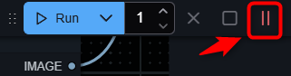

Click the play button to resume the queue.

### Stop / Clear Queue
Queue Manager restores the native ComfyUI queue stop / clear queue button that was removed in ComfyUI v0.4.0. Enjoy.

### Running and main Queue Manager window
You can start running jobs as usual using the Run button in the main ComfyUI window.

To view the Queue Manager window, click the Queue Manager button in the sidebar menu.

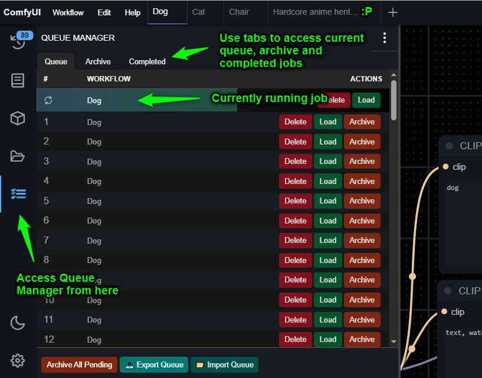

On the right you have action buttons like Delete, Load, Archive, Run which are applicable to a single item in the queue.

On the bottom you have buttons like Archive All, Export Queue etc. which are applicable to all items in the current tab.

When button on the bottom has a asterisk `*` next to it, it means that the action will be applied to the items in filtered view only (see **Filter by workflow** below).

### Archive
**Archive** is a place where you can park your queue items to play them later.

When in the **Queue** tab you can archive individual items by clicking the **Archive** button in the actions columns or you can archive all items in the queue by clicking the **Archive All** button on the bottom of the window.

Similarly, when in **Archive** tab you can play archived items by clicking the **Run** button in the actions column or you can play all archived items by clicking the **Run All** button on the bottom of the window.

#### Run at front of the queue
You can run an item, entire archive or filtered out list of jobs at the front of the queue by pressing and holding the **Shift** while clicking the **Run** or **Run All** buttons.

When holding Shift pressed a small indicator message will appear on top of the window to confirm that the action will run at front of queue.

### Export and Import

You can export items from any tab (Queue, Archive, Completed) to a file by clicking the Export Queue/Archive/Completed button on the bottom of the window.
You can import items from a file to the Queue or to the Archive by clicking the Import Queue/Archive button on the bottom of the window.

### Filter by workflow or name
Click a name in the Workflow column to filter the list. Above the active filters, use **Filter by: Workflow / Workflow name** to switch modes:

- **Workflow** shows jobs with the same workflow ID, including jobs that have been renamed.
- **Workflow name** matches the selected saved name exactly, including case, across workflows.

Note: renaming a job can remove it from an exact-name view if it no longer matches.

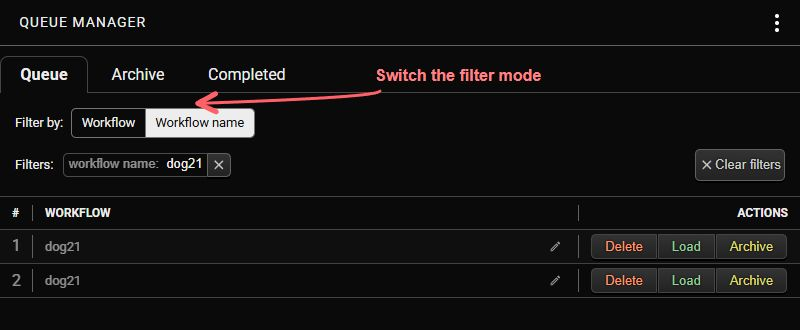

Once filtered out the group actions on the bottom of the window (like `Archive All *`, `Run All *`, `Delete All *`) will only apply to the filtered items.

Asterisk `*` next to the button label indicates that the action will be applied to the filtered items only.

### Select queue items
Click the checkbox icon to the right of the Queue / Archive / Completed tabs, or start dragging across the job list with your mouse, to enter selection mode. Outside selection mode, a normal click still filters the list or opens the gallery; dragging across rows selects them instead.

The hints below the tabs can be dismissed with **Don't show again**. To restore them, enable **Settings → Queue Manager → Basic → Show selection mode hints**.

- Click a row or its checkbox to select or deselect it. All individual action buttons stay available: **Archive**, **Delete**, **Run**, **Load**, and **View** work on that row without toggling its selection.
- **Shift-click** selects a range from the last row clicked without Shift; **Shift+Alt-click** deselects that range.
- Drag a rectangle to add every row it touches. Hold **Alt** while dragging to deselect those rows. The list scrolls when you drag near its top or bottom edge.
- Use the checkbox in the column header to select or clear the visible page. Press **Escape** or click the selection toggle again to exit.

While selecting, filters are disabled. Paging stays available; changing pages clears the selected items but keeps selection mode on. Footer actions become **Archive Selected**, **Run Selected**, **Export Selected**, and **Delete Selected**, as appropriate for the current tab. They stay disabled until at least one job is selected. Renaming is hidden during selection.

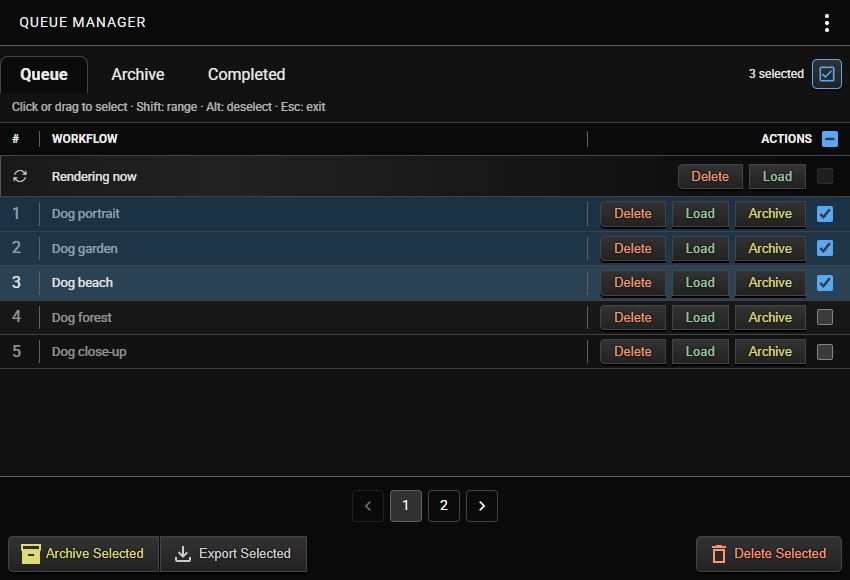

When an item action or automatic queue update refreshes the current page, only selected jobs still displayed on that page remain selected; newly displayed jobs are not selected automatically. Changing pages or tabs, changing the page size or list order, importing jobs, or opening the gallery clears the selected items while keeping selection mode on. Selection mode stays on until you click its toggle, press **Escape**, or reload the browser. Jobs that have started running or moved to another tab before an action reaches the server are skipped.

In Archive, **Run** moves an individual job to the queue while the remaining visible selections stay selected. **Run Selected** applies to the selected group.

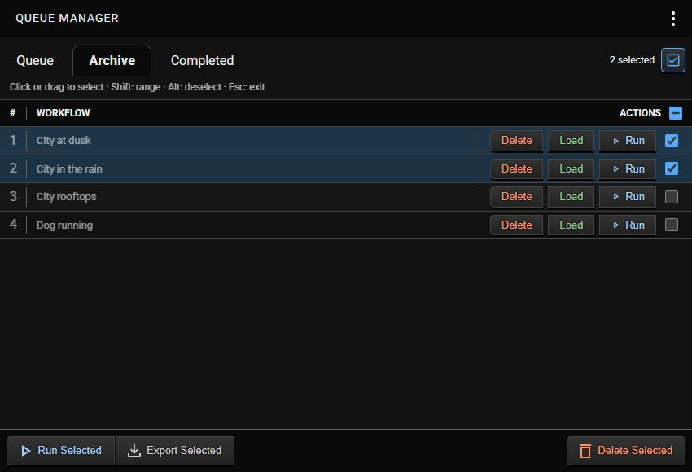

### Rename queued workflows
Click the pencil at the right edge of a pending or archived job's Workflow cell to edit its name. Moving focus outside the editor saves a changed name. You can also press **Enter** or click the checkmark to save; press **Escape** or click the cross to cancel. Empty names are rejected. Running, completed, and external jobs cannot be renamed.

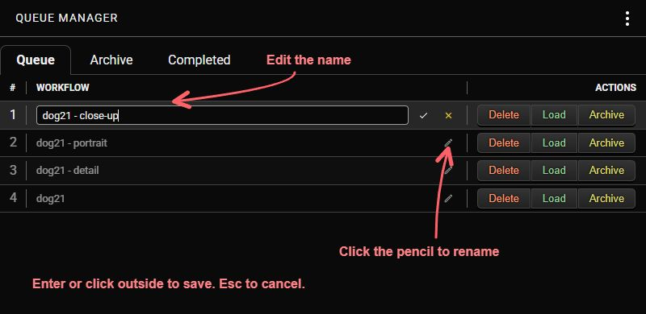

The change applies to that saved job, including its workflow-name metadata, and survives a restart or queue export/import. Names use the same filename sanitization as the Workflow Name node. Node text inputs and connections remain unchanged; a Workflow Name node with empty text uses the renamed metadata as its fallback during execution.

### Restore client focus
When you restart ComfyUI or browser, you might lose the client focus. When that happens the progress of running renders in ComfyUI will no longer update (no progress view, no previews, no highlights which nodes is being executed).

To restore the client focus, click the three vertical dots menu and select `Take over focus`. The effect will take place after currently running job (if any) finishes.

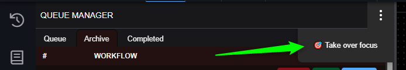

### Workflow Name node

Use Workflow Name to name queue entries and supply a filename prefix to other nodes. Type a value in `text` or connect a string to that same input. Custom values are sanitized for filenames; empty values fall back to the workflow filename, then an empty string if no filename is available.

Non-exhaustive list of typical use cases:

#### Name a queue entry

Enter a custom name such as `Hello`. The output can remain disconnected: Queue Manager still reads the node when queuing and uses the name for the queue entry.

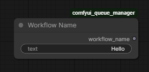

#### Save images using the workflow filename

Leave `text` empty and connect `workflow_name` to **Save Image**'s `filename_prefix` to use the workflow filename as the prefix for saved images.

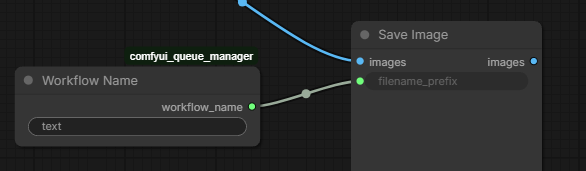

#### Supply a custom name from another node

Connect a string to `text` to supply the name from another node. In this example, `Hello` names the queue entry and provides the filename prefix for Save Image. A connected value replaces the manually entered text.

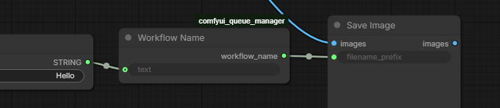

Queue Manager uses the first active Workflow Name node in the submitted prompt, ignoring muted or bypassed nodes. Connected values are read when available at queue time and may differ from the values produced during rendering. See the [node documentation](web/docs/Workflow%20Name.md) for sanitization and fallback details.

### External jobs
- Some third parties that queue through API don't supply full ComfyUI workflow context (i.e. ComfyUI plugin for Krita).
- Since these renders won't benefit from the Queue Manager features we delegate these jobs to native queue handler and mark as external.
- These jobs will appear in the native queue side bar; and the Queue Manager itself will indicate if such job is currently running.

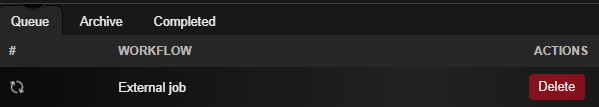
- Also any such jobs will always take precedence over items queued in Queue Manager.
- **IMPORTANT! This accommodation for such external jobs is a workaround measure.** When I have time I will investigate if there is a better way to handle this scenario. To avoid potential conflicts and unexpected behavior it's recommended to avoid using such third party plugins while running jobs from Queue Manager (and vice versa).

### Comfy API / Partner Nodes
1. This extension supports usage of Comfy API (Partner Nodes) in queued workflows.
2. To use Partner Nodes in queued workflows you must be logged in to Comfy.org using Comfy API Key (https://docs.comfy.org/account/login#logging-in-with-an-api-key).
3. When your Comfy API Key is deleted or revoked then all jobs in the queue that were queued with that key and used Partner Nodes, will fail. To run such jobs you need to requeue them; the best way to do it is to export them, log-in with your new Comfy API Key and then import the exported items back.
4. **IMPORTANT!** When you queue jobs while logged in with Comfy API key then those jobs will get through (and use your credits if you used Partner nodes) even if you log out from ComfyUI or Comfy.org.
5. Conversely, if you queue jobs with Partner nodes while NOT logged in with Comfy API key then those jobs will NOT be able to use Partner nodes even if you log in later before running them. (See point 3. above for export-import workaround).

### Gallery / output previews
- In the **Completed** tab you can view outputs (images and videos) of finished jobs.
- **Completed** tab can display results in 3 different modes: List, Cover, Grid.
- In **List** no media previews are shown, only job details. In **Cover** mode a first image is shown in the table. In **Grid** mode all media outputs (depending on settings) are shown in a grid layout.

- In every mode a small indicator next to the workflow name shows how many media outputs were produced by the job.
- Clicking on a thumbnail or outputs indicator opens the Gallery view.
- In Cover and Grid modes you can adjust size of the thumbnails using the slider on the bottom right of the window.

#### Gallery view
- In the **Gallery** view you can see all media outputs from the currently displayed **Completed** page. This is important to note: only outputs from jobs on current page will show in the gallery i.e. if there are 100 jobs per page then only outputs from those 100 jobs will be displayed in the gallery.
- You can cycle through media items individually or skip through entire jobs to quickly navigate through results.
- In the **Gallery** view several keyboard shortcuts are available:
  - **Arrow Left / Right**: go to previous / next media item
  - **Arrow Up / Down**: go to previous / next job
  - **Home**: go to first media item
  - **End**: go to last media item
  - **Escape**: close Gallery view
  - **T**: toggle thumbnails on / off
- On the bottom of the Gallery is a progress bar showing your current position in the list of media items. You can also use it to quickly skip to a specific media item by clicking on it.

- By default videos are played automatically. You can change that in extension settings (see below).
- When workflow produces both images and video outputs then images are hidden by default to reduce clutter (since most of the time these will be individual frames of the video). You can toggle visibility of these images in extension settings (see below).

### Extension Settings
- Several aspects of the Queue Manager extension can be configured in the ComfyUI Settings window.
  - **ComfyUI Menu -&gt; Settings -&gt;  Queue Manager**
  

## Troubleshooting
#### I updated custom nodes and can no longer load items from queue or play from Archive or items imported from file.

Sometimes updates to custom nodes introduce breaking changes to the node's internals that are incompatible with that node's old version. When that happens trying to play workflows with old version of the affected custom node will fail.

There is no permanent fix for this. You can either re-create the affected workflows with the updated version of the custom node or downgrade the offending custom note to the same version as the node used to queue the workflow that failed.

#### I updated ComfyUI and Queue Manager is no longer working properly.

In rare cases updates to ComfyUI introduce breaking changes that affect Queue Manager functionality.
Report the issue on the extension's GitHub page and I will try to address it as soon as possible.

#### I exported queue to file and imported on another device but I can't play it there

Similarly to points above, if the target device has different versions of custom nodes or different versions of ComfyUI they might be incompatible. There is no fix for that other than ensuring source and destination devices have same versions of ComfyUI and affected custom nodes.
Check the error message in the ComfyUI terminal to identify the affected custom nodes.

## Tips and words of wisdom
- Before updating ComfyUI or custom nodes it's best to finish all queued and archived jobs to avoid potential incompatibility issues with new versions of ComfyUI or custom nodes.
- While the ComfyUI Queue Manager offers data persistence between restarts and crashes as well as import/export functionality, it's not intended to provide a long term storage for queue jobs. Updates to ComfyUI and custom nodes might introduce breaking changes that will affect queued and archived jobs and make them unplayable. Run your queued and archived jobs as soon as possible to avoid such issues.

## Development
Don't lol. Things will change and move around a lot.
Nevertheless, here are some pointers if you have some PR ideas for critical fixes or features:
- `/web` is the front end part of the extension.
  - Inside is `.gui` folder which is hidden from default ComfyUI UI, but it's where the build version of the Queue Manager is.
- The core front end functionality of the Queue Manager is a React web app loaded in an iframe (from  `.gui` folder). It communicates with loading part of the extension by postMessage API.
- Server side (python) part of the extension is in `/src/comfyui_queue_manager`
- Source code for the React app is in `/src/gui`. I use bun to build it but you can as well use npm.
- database is in `/data/` (sqlite files are created automatically on first run after installation)

Better docs will come later.

## Have fun!
Queue all the way to the moon.

## Release Notes
For detailed release notes please see [CHANGELOG.md](CHANGELOG.md).
